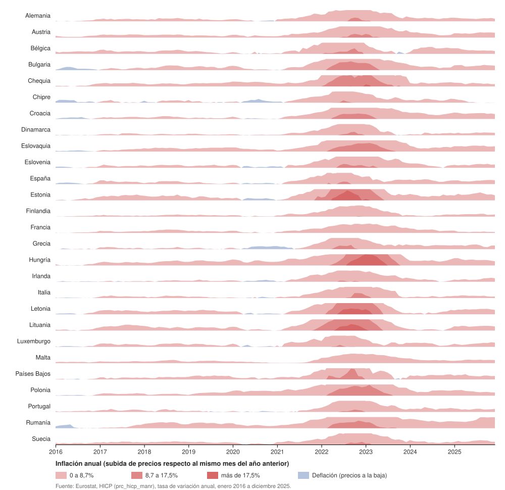

# Inflación en la UE, mes a mes, 2016-2025

**Fuente de los datos:** [Eurostat, HICP monthly data, annual rate of change (prc_hicp_manr)](https://ec.europa.eu/eurostat/databrowser/view/prc_hicp_manr/default/table?lang=en), enero 2016 a diciembre 2025.

**Software:** RAWGraphs, con el SVG personalizado con código.
