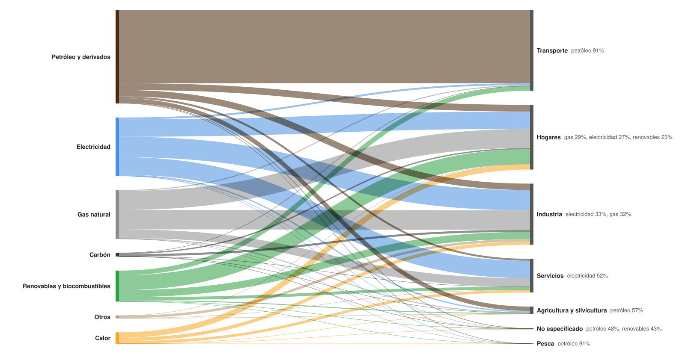

# ¿De qué energía depende cada sector de la UE?

**Fuente de los datos:** [Eurostat, Simplified energy balances (nrg_bal_s)](https://ec.europa.eu/eurostat/databrowser/view/nrg_bal_s/default/table?lang=en), 2024.

**Software:** RAWGraphs, con el SVG personalizado con código.
