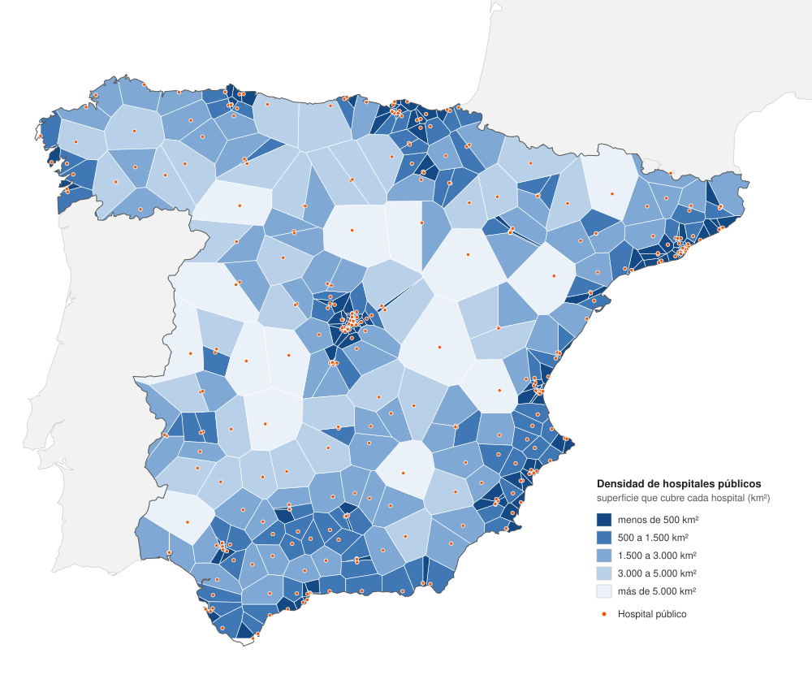

# ¿Cuánta superficie cubre cada hospital público?

**Fuente de los datos:** [Eurostat GISCO, Healthcare services in Europe](https://ec.europa.eu/eurostat/web/gisco/geodata/basic-services). Contorno: [Natural Earth, Admin 0 Countries 1:10m](https://www.naturalearthdata.com/downloads/10m-cultural-vectors/10m-admin-0-countries/).

**Software:** RAWGraphs, con el SVG personalizado con código.
